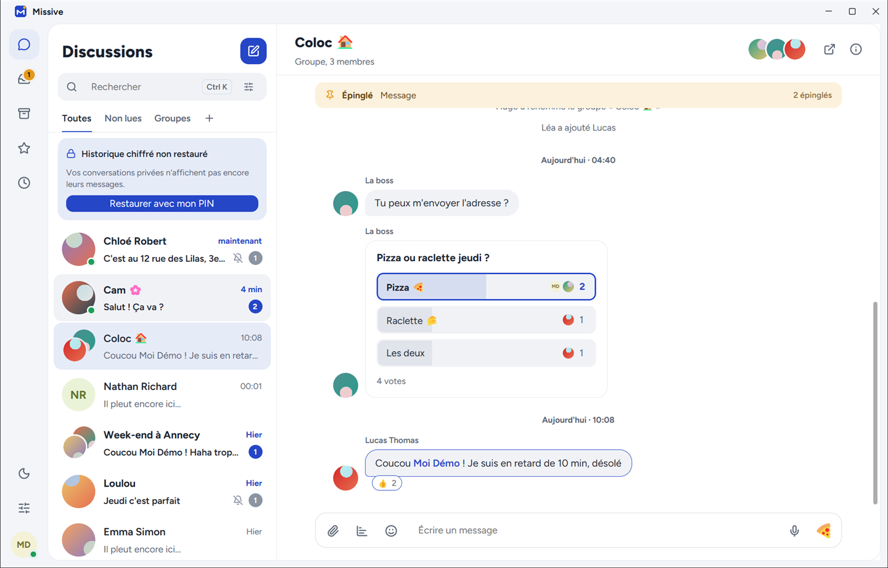
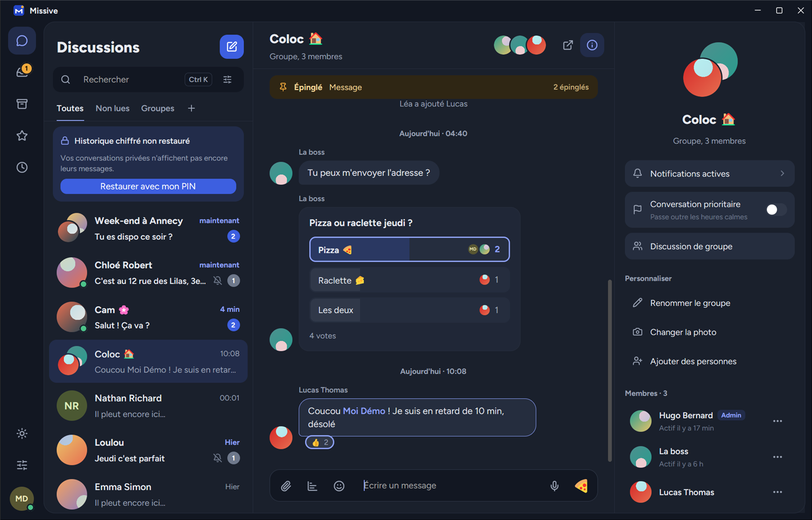
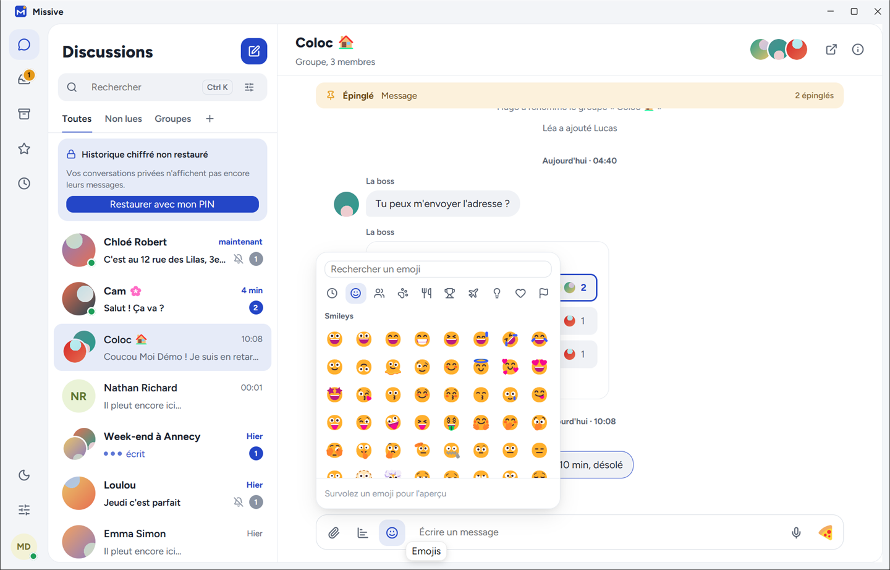

# Missive

[English](README.md) · [Journal des modifications](CHANGELOG.fr.md)

Client de bureau natif et non officiel pour Facebook Messenger, écrit en Rust (interface GPUI via
[`gpui-kit`](https://github.com/longbridge/gpui-kit)) avec un petit processus Go qui parle à Meta,
basé sur [mautrix-meta](https://github.com/mautrix/meta).



> **Avertissement.** Missive n'est ni affilié à Meta ni approuvé par Meta. Utiliser un client non
> officiel est contraire aux conditions d'utilisation de Meta et peut entraîner une vérification ou
> une suspension du compte. Vous l'utilisez à vos risques. Missive ne collecte rien : tout reste sur
> votre machine, et rien n'est envoyé ailleurs qu'aux serveurs de Meta.

## Ce que fait Missive

- **Toutes vos conversations**, y compris les discussions chiffrées de bout en bout (restauration de
  l'historique avec votre code PIN Messenger).
- **Messages complets** : réponses, réactions (et qui a réagi), mentions, modification et retrait,
  transfert, sondages, messages épinglés, liens enrichis, photos, vidéos, fichiers, positions,
  messages vocaux (écoute et enregistrement), emojis.
- **Conversations** : nouvelle conversation, groupes (renommer, photo, membres, admins), demandes
  de message, archives, sourdine, blocage, présence et dernière activité.
- **Au-delà du client officiel** :
  - envoi programmé et rappels sur un message ;
  - recherche avancée (`de:Hugo`, `dans:Coloc`, `a:photo`, `avant:mars 2025`, `après:hier`) et
    recherche dans la conversation (Ctrl+F) ;
  - favoris privés, dossiers personnels, réponses rapides avec `/` ;
  - mots-clés qui passent outre la sourdine, heures calmes, conversations prioritaires ;
  - lecture discrète (sans confirmation de lecture) et option pour ne pas afficher « écrit… » ;
  - export d'une conversation (HTML, Markdown, JSON) et téléchargement de tous ses médias ;
  - messages écrits hors connexion envoyés au retour du réseau.
- **Bureau** : notifications Windows avec réponse directe, badge de non-lus dans la barre des tâches
  et la zone de notification, fenêtre détachable, démarrage avec Windows, mises à jour
  automatiques, thèmes clair et sombre, taille du texte réglable.



## Installer

Téléchargez `Missive-win-Setup.exe` dans les [Releases](../../releases) et lancez-le. Missive
s'installe pour votre compte Windows uniquement (pas de droits administrateur) et se met à jour tout
seul. Les nouveautés de chaque version sont dans le [journal des modifications](CHANGELOG.fr.md).

Au premier lancement, connectez-vous à Messenger dans la fenêtre de connexion intégrée. Missive ne
voit jamais votre mot de passe : il garde seulement les cookies de session, chiffrés sur votre
disque avec la protection de données de Windows (DPAPI).

## Confidentialité

- Les cookies, jetons et le cache des messages sont chiffrés sur le disque
  (`%APPDATA%\Missive\bridge`). La base de clés du chiffrement de bout en bout et les médias
  téléchargés ne le sont pas ; ils restent protégés par les droits de votre compte Windows.
- Les journaux techniques (`%LOCALAPPDATA%\Missive\logs`) ne contiennent ni texte de message, ni
  noms, ni cookies. « Paramètres → Copier le diagnostic » vous permet de les partager pour signaler
  un bug.
- Aucune télémétrie.

## Compiler depuis les sources

Prérequis : Rust stable (MSVC sous Windows, Xcode sous macOS) et Go 1.26+.

```bash
cd bridge && CGO_ENABLED=0 go build -o missive-bridge.exe . && cd ..
cargo build --release
```

L'application cherche `missive-bridge(.exe)` à côté de son exécutable, puis dans `bridge/`, ou au
chemin donné par la variable `MISSIVE_BRIDGE`.

Mode démo, sans réseau et avec de fausses conversations (c'est ce mode qui a servi aux captures) :

```bash
cargo run -- --demo
```

Pour produire l'installeur Windows : `packaging/build-windows.ps1` (voir
[packaging/README.md](packaging/README.md)).

## Architecture

| Dossier | Rôle |
|---|---|
| `app/` | Interface Rust (GPUI) |
| `bridge/` | `missive-bridge`, processus Go basé sur mautrix-meta (`messagix` pour Messenger, whatsmeow pour le chiffrement de bout en bout) |
| `docs/bridge-protocol.md` | Protocole JSON lines entre l'interface et le bridge |
| `packaging/` | Installeur Windows (Velopack) et paquet macOS |

L'interface lance le bridge en processus enfant et lui parle sur stdin/stdout.



## Licence

AGPL-3.0-or-later. Le bridge dépend de mautrix-meta, lui-même sous AGPL-3.0. La police Figtree est
distribuée sous licence SIL Open Font License (`app/assets/fonts/Figtree-OFL.txt`).
