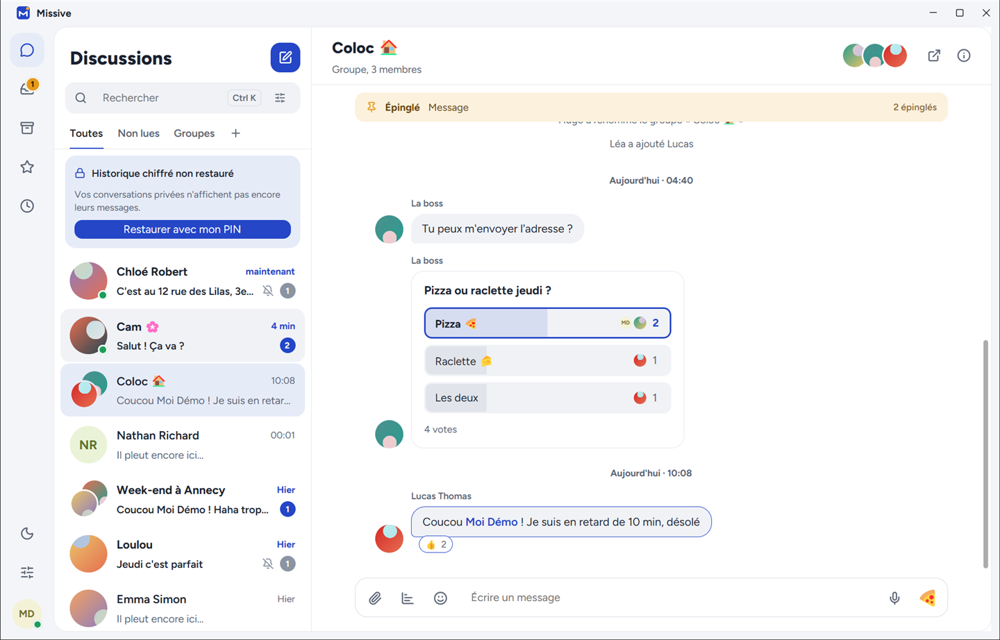
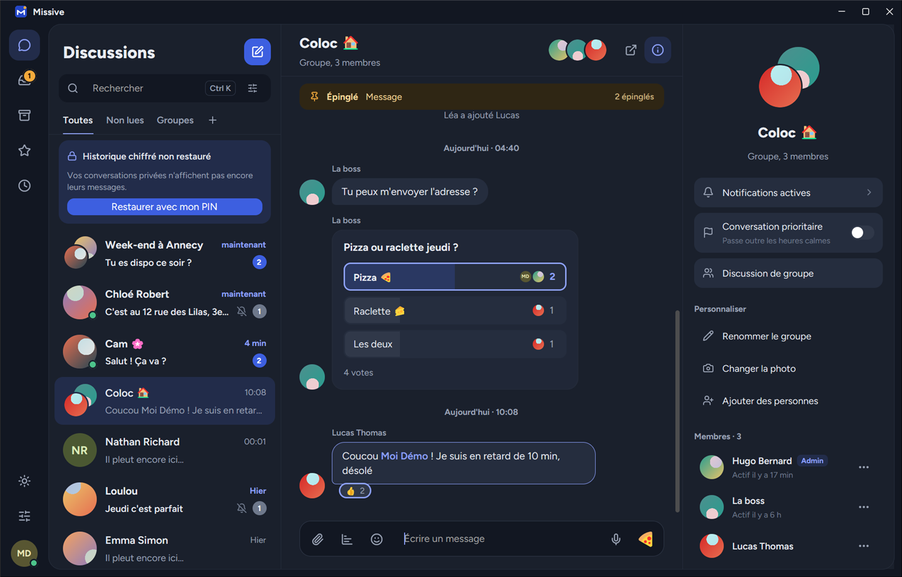
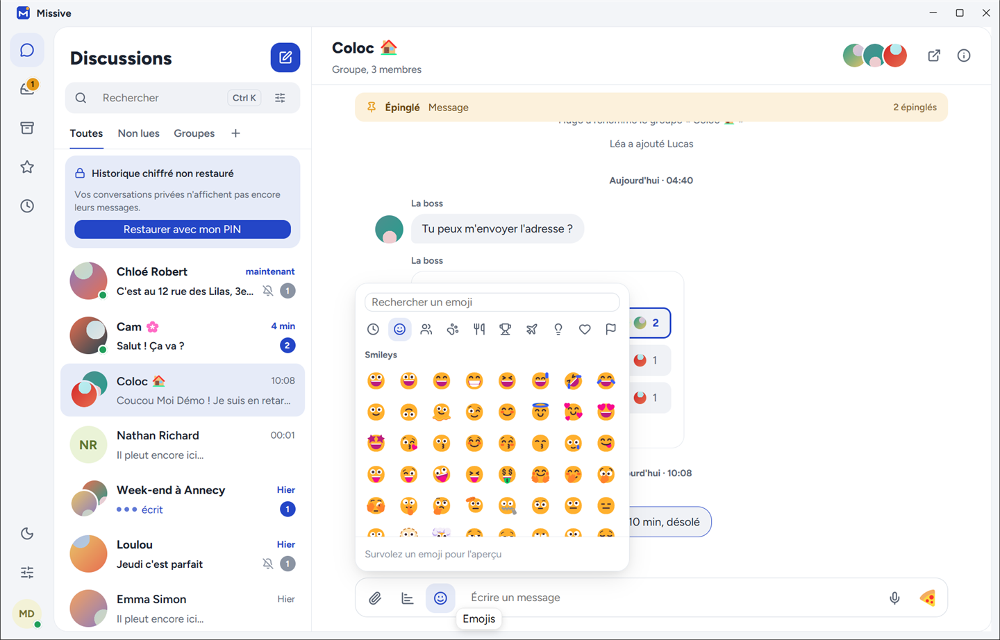

# Missive

[Français](README.fr.md) · [Changelog](CHANGELOG.md)

Unofficial native desktop client for Facebook Messenger, written in Rust (GPUI interface through
[`gpui-kit`](https://github.com/longbridge/gpui-kit)) with a small Go process that talks to Meta,
based on [mautrix-meta](https://github.com/mautrix/meta).

The interface is available in English and French: it follows your system language, and you can
change it in Settings.



> **Disclaimer.** Missive is neither affiliated with nor endorsed by Meta. Using an unofficial
> client goes against Meta's terms of service and may lead to an account check or suspension. Use
> it at your own risk. Missive collects nothing: everything stays on your machine, and nothing is
> sent anywhere other than Meta's servers.

## What Missive does

- **All your conversations**, including end-to-end encrypted chats (history restored with your
  Messenger PIN).
- **Full messages**: replies, reactions (and who reacted), mentions, edits and unsends, forwarding,
  polls, pinned messages, link previews, photos, videos, files, locations, voice messages
  (playback and recording), emoji.
- **Conversations**: new conversation, groups (rename, photo, members, admins), message requests,
  archive, mute, block, presence and last active time.
- **Beyond the official client**:
  - scheduled sending and reminders on a message;
  - advanced search (`from:Hugo`, `in:Roommates`, `has:photo`, `before:march 2025`,
    `after:yesterday`) and in-conversation search (Ctrl+F);
  - private favourites, personal folders, quick replies with `/`;
  - keywords that break through mute, quiet hours, priority conversations;
  - discreet reading (no read receipt) and an option to hide "typing…";
  - conversation export (HTML, Markdown, JSON) and download of all its media;
  - messages written offline are sent when the network comes back.
- **Desktop**: Windows notifications with inline reply, unread badge in the taskbar and the
  notification area, detachable window, launch at startup, automatic updates, light and dark
  themes, adjustable text size.



## Install

Download `Missive-win-Setup.exe` from the [Releases](../../releases) and run it. Missive installs
for your Windows account only (no administrator rights) and updates itself. What changed in each
version is in the [changelog](CHANGELOG.md).

On first launch, sign in to Messenger in the built-in login window. Missive never sees your
password: it only keeps the session cookies, encrypted on your disk with Windows data protection
(DPAPI).

## Privacy

- Cookies, tokens and the message cache are encrypted on disk (`%APPDATA%\Missive\bridge`). The
  end-to-end encryption key store and downloaded media are not; they stay protected by your Windows
  account permissions.
- Technical logs (`%LOCALAPPDATA%\Missive\logs`) contain no message text, names or cookies.
  "Settings → Copy diagnostics" lets you share them to report a bug.
- No telemetry.

## Build from source

Requirements: stable Rust (MSVC on Windows, Xcode on macOS) and Go 1.26+.

```bash
cd bridge && CGO_ENABLED=0 go build -o missive-bridge.exe . && cd ..
cargo build --release
```

The app looks for `missive-bridge(.exe)` next to its executable, then in `bridge/`, or at the path
given by the `MISSIVE_BRIDGE` environment variable.

Demo mode, offline and with fake conversations (the screenshots were taken in this mode):

```bash
cargo run -- --demo
```

To build the Windows installer: `packaging/build-windows.ps1` (see
[packaging/README.md](packaging/README.md), in French).

## Architecture

| Folder | Role |
|---|---|
| `app/` | Rust interface (GPUI) |
| `bridge/` | `missive-bridge`, Go process based on mautrix-meta (`messagix` for Messenger, whatsmeow for end-to-end encryption) |
| `docs/bridge-protocol.md` | JSON lines protocol between the interface and the bridge |
| `packaging/` | Windows installer (Velopack) and macOS package |

The interface starts the bridge as a child process and talks to it over stdin/stdout.



## License

AGPL-3.0-or-later. The bridge depends on mautrix-meta, itself under AGPL-3.0. The Figtree font is
distributed under the SIL Open Font License (`app/assets/fonts/Figtree-OFL.txt`).
